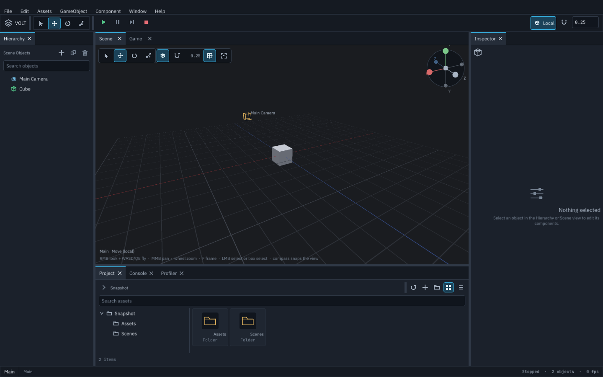
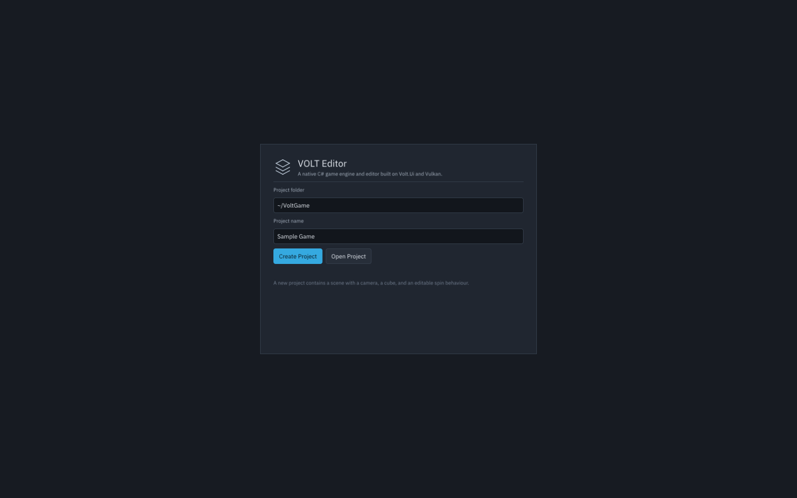
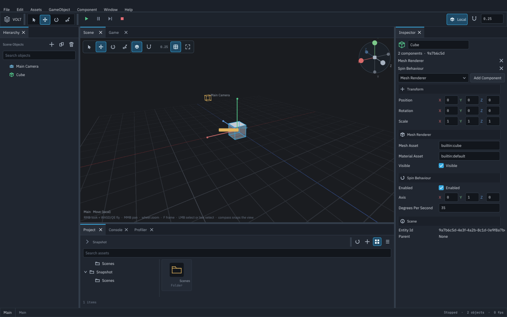

# VOLT Editor

`Volt.Editor` is a standalone graphical editor built entirely from
`Volt.Ui` widgets and presented by the engine's Vulkan backend. Itdoes not embed ImGui, Avalonia, WPF, WinForms, or Qt.



## Running

```bash
dotnet run --project src/Volt.Editor
```

Open an existing project folder directly; replace `/tmp/MyGame` with any
absolute path. Without `--project` the editor starts on its start screen
instead:

```bash
dotnet run --project src/Volt.Editor -- --project /tmp/MyGame
```

Optional flags:

| Flag | Effect |
| --- | --- |
| `--validation` | Enables Vulkan validation layers |
| `--project <folder>` | Opens a project with a `project.volt.json` |
| `--frames <count>` | Runs a fixed number of frames, then exits |
| `--width <pixels>` | Opens at a specific width (minimum 640) |
| `--height <pixels>` | Opens at a specific height (minimum 480) |
| `--ui-scale <factor>` | Interface scale: `0.75`, `1`, `1.25`, `1.5`, `2` |
| `--snapshot <file>` | Writes the whole editor to a PNG and exits, without a window or a GPU |
| `--snapshot-state <state>` | Snapshot preset: `workspace` (default), `authoring`, or `start` |

`--snapshot` lays the shell out headlessly at `--width` by `--height`,
simulates three frames so the dock and every panel reach their steady
state, and rasterizes the resulting draw list on the CPU. Without
`--project` it uses a temporary starter project, so the image shows the
real workspace rather than the start screen. The Scene view publishes
the same render request a window would, and `SoftwareSceneRenderer`
rasterizes its meshes and ground grid on the CPU with clipping, a depth
buffer, the scene's authored directional light, and supersampled edges, so the
capture contains real 3D content instead of a placeholder. Game view
content appears the same way while Play Mode has a running world.
Everything the UI draws itself — surfaces, borders, icons, labels,
gizmos, and overlays — is real too. This is how the interface can be
reviewed or diffed on a machine with no display server, and
`tests/Volt.Editor.Tests/EditorSnapshotTests.cs` asserts that a whole
shell frame renders, encodes, and honours the interface scale.

Two captures are also golden-image regression tests:
`tests/Volt.Editor.Tests/GoldenSnapshotTests.cs` compares them against
the PNG baselines in `tests/Volt.Editor.Tests/Baselines`, allowing a
small per-channel difference and a fraction of a percent of differing
pixels so a new runtime does not fail the build while a moved panel, a
lost label, or a wrong colour does. After an intentional interface
change, rewrite the baselines with
`VOLT_UPDATE_SNAPSHOTS=1 dotnet test tests/Volt.Editor.Tests --filter GoldenSnapshotTests`
and review the new images before committing them.

`--snapshot-state` selects what a capture shows. `workspace` is the
default: a temporary starter project with no selection. `authoring`
selects the first mesh object and activates Move, so the hierarchy,
scene gizmo, and populated inspector all appear. `start` captures the
start screen before any project is open and cannot be combined with
`--project`; its folder field shows `~/VoltGame` so the image does not
depend on the checkout's path.

The images embedded in this guide are generated from that same command
at 1440 by 900 and committed under `docs/images`. Regenerate them with:

```bash
./tools/capture-editor-docs.sh
```

Pass `--check` to capture into a temporary directory and compare each
committed image using a per-channel and differing-pixel tolerance, the
same rule as the golden baselines. That lets harmless platform
antialiasing differences pass while a moved panel, a changed label, or
a wrong colour fails. The hosted CI build runs this check. After an
intentional visual change, regenerate the images and review them before
committing.

The editor requires a working SDL3 video backend and a Vulkan device
with presentation support. It compiles and its logic is unit tested on
Linux, but windowed execution has not been exercised: the build
machine this work was done on has no display server, no `/dev/dri`
node, and no Vulkan driver, so a window cannot be created and no UI
frame has been presented on a GPU. Hardware validation is the job of
the repository's own GPU harness (`tools/test-vulkan-headless.sh` and
the manual `vulkan-gpu` CI job), which documents its runner
prerequisites; see `tools/README.md`.

## First project



The start screen asks for a project folder and a project name. It
creates:

```text
MyGame/
  project.volt.json
  Assets/
  Scenes/
    Main.volt.scene.json
```

The starter scene contains a camera and a cube with the built-in spin
behaviour. `project.volt.json` is versioned and points at the startup
scene. Paths are project-relative and may not escape the project root.

When a project is already open, **File → New Project…**, **File →
Open Project…**, and **Window → Start Screen** show this screen over
the workspace. **Back to Editor** returns to the open scene without
changing it, so opening the screen by mistake is harmless.

## Layout

```text
Menu bar (File, Edit, Assets, GameObject, Component, Window, Help)
Toolbar (VOLT mark | Select Move Rotate Scale | Play Pause Step Stop
         | Local/World, grid snap and its increment)
+-----------+-----------------------------+------------+
| Hierarchy | Scene / Game tabs           | Inspector  |
|           +-----------------------------+            |
|           | Project / Console /         |            |
|           | ECS / Profiler              |            |
+-----------+-----------------------------+------------+
Status bar (scene, last action, play state, object count, frame rate)
```

The menu bar, toolbar, and status bar are fixed-height rows of one
vertical stack, and the workspace between them is the row that declares
`FlexGrow`. That is what keeps the status bar on the bottom edge and
ends the dock area where the status bar begins, at any window size:
a row that fills the space it is offered would otherwise claim the
whole surface and push the rows after it out of the window.
`tests/Volt.Editor.Tests/EditorShellLayoutTests.cs` lays the shell out
headlessly at real window sizes and asserts that chrome placement,
panel containment, paint clipping, and hit testing all agree.

Panels are real `DockHost` panels. Drag splitters to resize, drop a
panel onto another tab group to combine them, and use **Window** to
close or reopen panels. The layout is serialized to
`<project>/.volt/workspace.json` when the editor closes and restored
the next time that project is opened. The editor window's size and
position are saved with the other editor settings and reopened there,
clamped to a usable size; a window closed maximized keeps its previous
restore size and position instead of reopening a normal window at screen
size. A saved position is used only when it still falls on a connected
display. Opening a project from the start screen adopts that project's
saved target frame rate, interface scale, and window geometry, and the
settings saved on exit belong to the project that is open rather than
the one the editor started with.

## Interface design

The shell is styled by one design system in `Volt.Ui` rather than by
per-panel colors, so the chrome, the docked panels, the popups, and
the viewport overlays share a palette and a type scale.

- **Surfaces step by role.** Chrome (menu bar, toolbar, status bar) is
darker than panel surfaces, raised controls are lighter than the
panels that host them, and sunken areas — the scene viewport, text
fields, list wells — are darkest. That gradient carries the visual
hierarchy, so most elements need no border at all.
- **The accent marks state, not decoration:** the active tool, the
selected row, the focused field, the current tab, and the primary
button.
- **Interaction states are distinguishable** on every control. Hover,
pressed, selected, focused (an accent ring), and disabled each resolve
to a different style; icon-only controls carry tooltips.
- **Icons are vector geometry.** `UiIconPainter` draws the whole
vocabulary from polygons and polylines, so icons stay sharp at any
interface scale and need no image assets. Toolbar tools, panel
actions, hierarchy rows, asset tiles, and console severities map to it
through `EditorIcons`.
- **Empty states are deliberate.** A panel with nothing to show draws
an icon, a title, and a sentence instead of an empty rectangle: no
scene, no objects, no matches, no project, nothing selected, an empty
folder, or a filtered-out console.
- **Typography is a role scale** (`Small`, `Body`, `Large`, `Heading`,
`Title`, `PanelHeader`, `Mono`, `MonoSmall`). Body text is 15 logical
units with a 14-unit panel header; numeric fields use the monospace face
so digits align down a column, and inspector rows label their X/Y/Z
components in the conventional muted red, green, and blue.
- **Colour is authored in sRGB and composited in linear light.** The
palette records the bytes a developer should see. When the swapchain
format applies the sRGB transfer function, the UI shader decodes those
bytes before blending so the framebuffer does not encode them a second
time; a surface that only offers a UNORM format passes them through.
That is why a panel declared as `#1B212B` renders as `#1B212B` instead
of the much brighter value a double encode produces.

The tool strip groups tools, transport, and view context, and the
status bar reports the scene and its dirty marker, the last action,
the play state, the live object count, and a smoothed frame rate.

### Interface scale

**Window → Interface Scale** (also in **Edit → Preferences…**) sets the
whole interface to 75%, 100%, 125%, 150%, or 200%; `--ui-scale` sets
the same value at startup. Fonts rasterize at the scaled size instead
of being magnified, and panel widgets are rebuilt so the new metrics
apply everywhere. Project, scene, workspace, and undo state live in
the session, so scaling loses nothing.

**Window → Reset Layout** restores the default arrangement and split
ratios without discarding the state inside open panels.

## Authoring



- **Hierarchy** lists the authored scene. Select one or more objects,
  rename them, and create, duplicate, or delete them from the context
  menu or the menus. Deleting a multi-selection removes every selected
  object in one undo step, and a selected child is left to its selected
  parent rather than being deleted twice. Duplicating does the same:
  every selected object is copied with its children, the copies are
  named uniquely and left selected, and the whole operation is one undo
  step (redo recreates the same copies, ids included). Acting on a row
  that already belongs to a selection keeps that selection, so its
  commands reach all of it. **Rename** in the row's context menu, or
  `F2`, focuses the inspector's name field with the current name
  selected; Enter commits the rename and Escape restores it.

  Drag a row onto another row to re-parent it, or onto the empty space
  below the rows to move it back to the scene root. The row that will
  receive it is outlined while the drag is in flight, a target inside
  the dragged object's own subtree is refused instead of being offered,
  and dragging one row of a selection moves the whole selection as a
  single undo step. A press that never becomes a drag still selects the
  row, so plain clicking is unchanged.
- **Inspector** edits the selected object's transform and every
  supported component. Values are written through undoable commands;
  the vector, color, numeric, enum, and asset properties all come from
  the component catalog rather than hardcoded editor code. The **Add
  Component** list offers only components the object does not already
  have; the list and button disable themselves once every registered
  component is present.
- **Scene view** is the authoring view. VOLT renders the scene's
  meshes and the ground grid into an offscreen target with depth
  testing, and the panel samples that image, so what it shows is real
  rendered geometry. Selection outlines, labels, and gizmos are UI
  overlays drawn on top of it.
- **Directional lights are authored objects.** **GameObject → Create
  Light** adds one as a selected, undoable object. A light shines along
  its world +Z axis, so rotate it to aim it; **Color** and
  **Intensity** are inspector properties. The Scene view draws a sun
  marker at the light's position and a short arrow along its beam, so
  it stays findable and aimable while it is off or unselected. A light
  with zero intensity is drawn in the muted color but keeps its normal
  label; disabling it also crosses the marker out and labels it
  `(off)`. A scene uses the first enabled directional light in
  hierarchy order, and falls back to the editor's default key light
  when it has none.
- **Selection works the way an editor's does.** A click takes one
  object, shift-click adds another, and dragging on empty space with the
  left button draws a box that takes every object its bounds touch
  (shift keeps what was already selected). The hierarchy highlights the
  whole selection, the inspector edits every selected object and says so
  under the name, and the gizmo follows the active one. With more than
  one object selected, the scene view also frames the selection's
  combined extent in corner brackets labelled with the object count, so
  the reach of a group edit is visible before it is applied.

  A transform edit reaches the whole selection. Dragging a gizmo handle
  or typing a position, rotation, or scale moves every selected object by
  the same delta, so a group keeps its spacing, and the gesture is one
  undo step rather than one per object. A child of another selected
  object is left out of that delta: its parent already carries it, and
  moving both would move it twice. A group rotation turns each object in
  place instead of orbiting it around the active object.
- **The scene view's floating chrome** carries the controls an author
  reaches for without leaving the image: the four tools, the gizmo
  space, grid snapping and its increment, the ground-grid toggle, and
  frame-selection. It wraps onto a second row instead of running off a
  narrow view, disables the tools while the scene is running, and
  explains each control with a tooltip. The orientation compass in the
  corner shows where the camera looks from and snaps it to an axis, or
  back to the default angle from its centre, keeping the current zoom.

  Navigate it like a first-person camera: hold the right mouse button
  to look, keep it held and fly with `W`, `A`, `S`, `D`, `E` or `Space`
  for up and `Q` for down, hold `Shift` to sprint, drag with the middle
  button to pan, and scroll to dolly. `F` frames the selection, or the
  whole scene when nothing is selected. Left-click selects, `Shift`
  adds to the selection, and clicking empty space clears it.

  Translate, rotate, and scale gizmos are drag handles drawn over the
  render: drag one axis for that axis, or the square plane handle for
  the XZ plane. A gesture previews live on every selected object and is
  committed as one undo step instead of one step per drag frame.
- **Project** browses the project folder through the asset catalog and
  can assign asset references in the inspector. Its **New Scene**
  action opens the scene and moves the browser to the scene's folder
  so the new tile is visible. Its **New Folder** action creates a
  directory in the current folder (or in `Assets` at the project root),
  leaves it selected, and shows empty directories in both the folder
  tree and the contents so a new folder does not disappear until a
  file is added. Grid and list modes share the selected assets, so
  switching views keeps every selected item highlighted and moves
  keyboard focus onto the active one, leaving `F2`, `Delete`, and
  arrow navigation ready to use. `Ctrl`-click toggles an item,
  `Shift`-click selects a range, and `Shift`+arrow extends a range in
  the grid. The details line reports how many assets are selected.
  The folder tree keeps the current folder selected and
  its collapsed branches collapsed as it rebuilds, and the selected
  item's details survive a refresh. Switching between tiles and the
  list scrolls the selected item into view, and the arrow keys move
  the selection and focus between neighboring tiles, keeping the
  active tile in view. Changing the interface scale preserves the
  browser's folder, view, search, and selection. Opening another
  project returns the browser to that project's root and clears its
  search filter. Right-click an asset for **Open**, **Rename…**,
  **Duplicate**, or **Delete**. Renaming keeps the file extension; the
  open scene keeps saving to its new name, and renaming the startup
  scene updates the project manifest. Renaming rewrites matching asset
  paths in every scene component, including unknown component data, so
  mesh, material, and texture references follow the file. Deleting
  clears those references instead of leaving them dangling.
  Duplicating writes a numbered sibling such as
  `Main 1.volt.scene.json`, selects it, and never overwrites an existing
  file. Duplicating a multi-selection copies every selected file into
  numbered siblings in one action, selects the copies, and skips names
  already taken by the selection or the folder. With a tile or list row
  focused, `F2` opens the same rename dialog for one asset, `Ctrl+D`
  duplicates the selection, and `Delete` removes the whole selection
  through one confirmation. Deleting is refused if any selected file is
  the open or startup scene, since either would leave the editor or
  project pointing at a missing file. Right-click a folder tile or
  folder-tree row for **Rename…**. Renaming moves the directory and
  rewrites folder-prefixed asset references in every scene, including
  unknown component data; the startup scene and the open scene keep
  their new paths. The `Assets` and `Scenes` roots cannot be renamed.
  Scene shortcuts such as Delete and F2 stand down while the browser
  has keyboard focus; the asset shortcuts require the tile or row
  itself to have focus, so the search field and folder tree keep their
  keys.
- **Console** records editor actions and errors.
- **Profiler** reports frame timing and runtime counts while the
  editor is running.

Selection commands live in the **Edit** menu: **Select All**
(`Ctrl+A`), **Select None** (`Ctrl+Shift+A`), and **Invert Selection**
(`Ctrl+I`). They work on the whole scene regardless of the hierarchy's
search filter, and they keep the active object active whenever it is
still selected, so the inspector does not jump to an unrelated object.

Keyboard shortcuts: `Ctrl+S` save, `Ctrl+Z` undo, `Ctrl+Y` or
`Ctrl+Shift+Z` redo, `Ctrl+D` duplicate selection, `Delete` delete
selection, `F2` rename the active object, `Ctrl+A` select all,
`Ctrl+Shift+A` select none, `Ctrl+I` invert selection. In the Project
browser, the arrow keys move through the tiles, `Shift`+arrow extends
the selection, `F2` renames one asset, `Ctrl+D` duplicates the selected
assets, and `Delete` removes all selected assets. While a text field
has focus, `Ctrl+Z` and `Ctrl+Y` undo and redo that field's text
instead of the scene, and `Ctrl+S` applies the field before writing
the scene. Closing the window applies it before deciding whether to
prompt for unsaved work.

Saving writes a temporary file and moves it into place, so a failed
save cannot truncate the previous scene. Unknown components are kept
as raw JSON instead of being dropped.

Opening another scene or project, creating a scene, or closing the
editor while the current scene is dirty asks **Save**, **Discard**, or
**Cancel**. Save writes the current scene before the operation
continues, Cancel leaves it open and dirty, and closing the window uses
the same prompt instead of discarding the scene silently. **File →
Close Project** returns to the start screen through the same guard.

## Play Mode

The toolbar's Play button serializes the authored scene, loads that
snapshot as a fresh ECS world, and starts a fixed-step simulation
(1/60 s). Game view shows the running world. **Pause**, **Step**, and
**Stop** control it.

Runtime state is separate from authored state: stopping disposes the
runtime world and the authored scene is not written back. This is
covered by `tests/Volt.Editor.Tests` and
`tests/Volt.Editor.Core.Tests/Runtime/PlaySessionTests.cs`.

## Runtime ECS inspector

The **ECS** panel (bottom tab group, and **Window → ECS**) reports the
world Play Mode actually built, not the authored scene. While a session
is running it shows:

- the session state and the live entity and archetype counts;
- the selected object's runtime ECS handle, its real component
  signature, and the values read from its component columns;
- every allocated archetype with its entity count, chunk count,
  occupancy, and the native bytes its chunks report;
- a query builder that runs `World.Query` with every checked component
  required and reports the matched archetypes and entity count.

Values refresh four times a second instead of on every fixed step, and
each capture copies every value it displays, so stopping Play Mode
cannot leave the panel holding a reference into chunk storage.

Position, scale, velocity, and angular velocity are editable while Play
Mode is running or paused. The write-back rule is deliberately narrow:
an edit changes the live ECS component and nothing else. It does not
touch the authored scene, mark it dirty, or create an undo entry, and
stopping Play discards it with the rest of the world. The panel only
writes components the entity already has; it never adds or removes one,
because that would migrate the entity between archetypes from the UI
thread. A running system can overwrite the value on its next tick, and
the panel says so rather than implying the edit is permanent. Change
saved values in the authored Inspector.

Rotation stays read-only here: the runtime stores a world-space
quaternion, while authored Euler angles live in the Inspector.

Inspecting a paused world works the same way, which is the useful case
for comparing a simulated pose with the authored transform.

## Running a game without the editor

Gameplay data is normal project data. `samples/Volt.PlayDemo` is an
independent executable that:

1. Opens `samples/Volt.PlayDemo/SampleGame` through the same project
   API the editor uses.
2. Loads the startup scene.
3. Starts a `PlaySession`.
4. Presents its own window with `VulkanUiHost` and a Volt.Ui HUD.

```bash
dotnet run --project samples/Volt.PlayDemo
```

Add `--frames N` to bound a run so it exits by itself, and `--validation`
to load the Vulkan validation layer. A run prints the selected GPU, whether
validation is enabled, and `Presented N accepted frames.` on exit; a bounded
run that presents the wrong number of frames exits non-zero.

```bash
dotnet run --project samples/Volt.PlayDemo -- --create /tmp/NewGame
```

`--create` writes only into a folder that does not exist yet or is empty,
so it cannot overwrite work in progress. Running it twice reports that the
folder `already contains files`; open the existing project with
`--project <folder>` instead.

The created project contains a player object with the built-in move
behaviour (`Axis`, `Speed`, `Automatic`) and can be opened, edited, and
saved in the editor before running it again.

The demo's viewport projects runtime ECS positions through a fixed
camera into Volt.Ui draw commands. It demonstrates scene ownership,
fixed-step simulation, input sampling, and independent execution; it is
not yet a mesh-rendering game framework.

## Project structure and assemblies

| Assembly | Responsibility |
| --- | --- |
| `Volt.Ui` | Widget tree, layout, styling, text, input, draw lists, docking |
| `Volt.Ui.Vulkan` | Vulkan UI renderer and window host |
| `Volt.Editor.Core` | Authored scenes, serialization, projects, undo, runtime, play sessions |
| `Volt.Editor` | Editor session, shell, panels, viewports, executable |
| `Volt.Ecs` | Archetype ECS used by runtime worlds |

`Volt.Ui` does not reference `Volt.Ecs` or `Volt.Editor.Core`.

## Current limitations

- Scene and Game views sample a rendered offscreen target, but that
  rendering is one pass per viewport with no shadows or post-processing
  in a window, and the only meshes a scene can reference are the
  built-in primitives. A render target is recreated only when its
  viewport's pixel size changes. The headless snapshot uses a separate
  CPU rasterizer for the same requests; it is a review approximation of
  the GPU image, not a pixel-exact copy of it.
- Gameplay logic is currently composed from the built-in behaviours
  (`Spin`, `Move`) and authored component data. Loading user-authored
  C# assemblies into a separate runtime is not implemented.
- The ECS panel edits only components the selected runtime entity
  already has. Runtime entity creation, adding or removing components,
  rotation editing, and per-entity query result lists are not
  implemented; the query reports matched archetypes and counts.
- Floating dock windows, asset thumbnails, and an asset import pipeline
  beyond discovery are not implemented.
- Text entry covers Unicode text and clipboard operations. IME
  candidate windows and complex shaping are not implemented.
- Windows was not available to verify; code paths are platform-neutral
  and use SDL3 and Vulkan, but only Linux builds and tests were run.
- The editor has no automated UI test that opens a native window.
  Session, scene, project, undo, play mode, dock layout, rendering
  geometry, and the whole shell's layout, clipping, and hit testing are
  covered headlessly, and `--snapshot` rasterizes the chrome and the
  scene's meshes and grid into a PNG. Only a window on a GPU exercises
  the Vulkan scene pipeline; the CPU rasterizer approximates its edge
  coverage and depth precision rather than matching it pixel for
  pixel.
- In a window shorter than a panel's minimum content, that panel clips
  its own overflow rather than scrolling it. The strict
  no-geometry-outside-the-window check therefore runs at the window the
  editor opens with.

## Where to look

- `docs/ui-framework.md` — UI programming model and rendering contracts.
- `samples/Volt.UiDemo` — standalone UI application.
- `samples/Volt.PlayDemo` — standalone game execution.
- `tests/Volt.Ui.Tests`, `tests/Volt.Editor.Core.Tests`,
  `tests/Volt.Editor.Tests` — headless behavior tests.
- `benchmarks/Volt.Benchmarks/UiBenchmarks.cs` and
  `tools/benchmark-results/ui-headless-2026-10-27` — measured UI cost.
